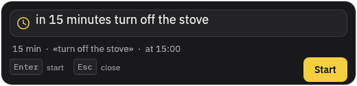
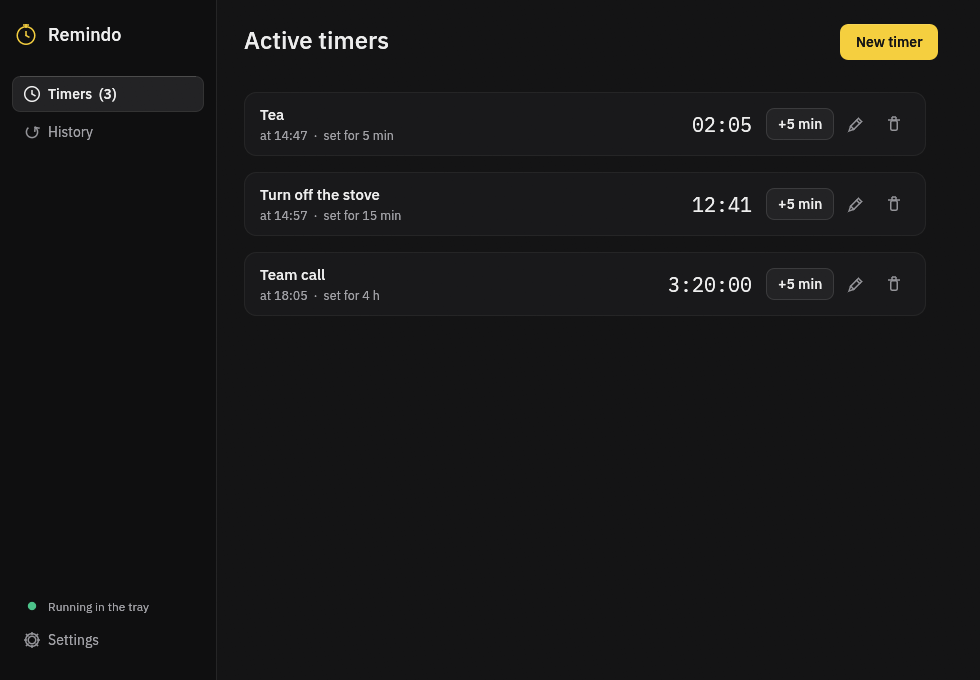
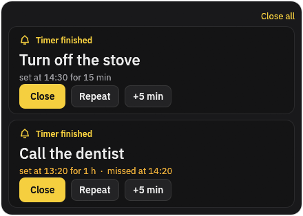
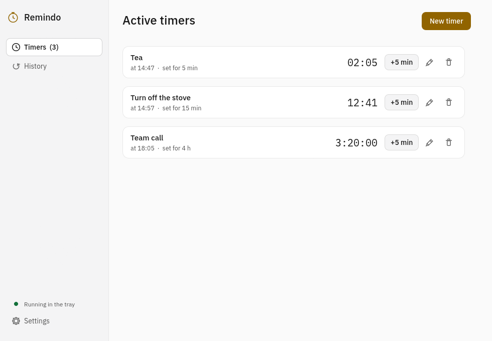
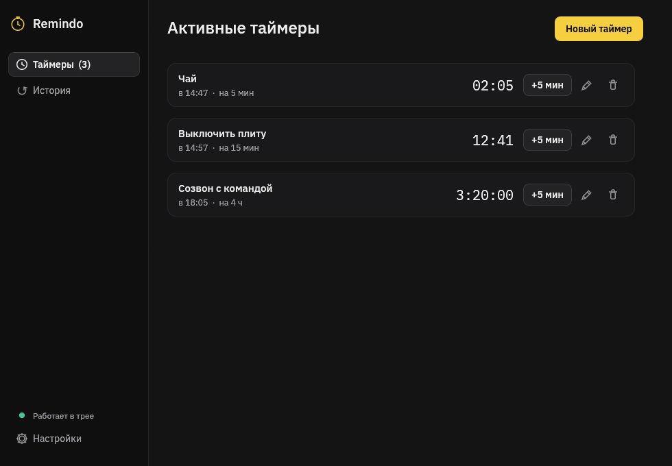
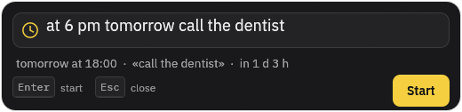
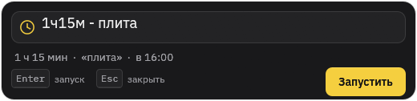
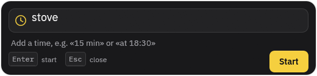

# Remindo

Quick timers from a hotkey, for Windows and Linux. Press a shortcut, type `in 15 minutes turn off the stove` (or `через 15 минут выключить плиту`, or `через 15 хвилин вимкнути плиту`), press Enter, and a small window pops up when the time comes. It lives in the tray, keeps your timers across restarts and reboots, and works offline. No account, no cloud. Part of the [NIMVORO](https://github.com/GrigoryyKach/nimvoro) suite.



## Features

- **Type it the way you say it.** English, Russian and Ukrainian, mixed, any case: `1h15m - stove`, `15мин, плита`, `через полчаса позвонить`, `за півгодини нагадай`, `завтра о 9`, `at 6 pm`. See [The parser](#the-parser).
- **A live preview.** One line under the input shows what was understood: the length, the note and when it fires, for example `1 h 15 min · «stove» · at 19:42`. A clock time that already passed today means tomorrow, and the preview says `tomorrow at 06:00`. When the text has no time, it says what to add.
- **The quick input.** A small borderless, rounded, topmost window, 520 by 126, centred on the monitor that holds the mouse cursor and focused at once. Enter or the Start button creates the timer, Escape or a click outside closes it, the Up arrow brings back the last entry. Pressing the shortcut while it is open focuses it; there is never a second one.
- **When a timer fires.** A small topmost window on the monitor with the cursor shows the note big, `Timer finished · set at 19:27 for 15 min`, and the buttons **Close**, **Repeat** (the same length again, the same note) and **+5 min**. It is shown without activation, so it does not take the keyboard from the program in front. Several timers that fire together stack in one window.
- **Never lose a timer.** Timers are stored with absolute times: they survive a restart, a reboot, sleep and a time zone change. A timer that came due while Remindo was closed fires at start, marked `missed at 14:05`.
- **Precise.** A scheduler thread sleeps until the next due time (never polls frames), wakes for a resume from sleep and looks at the wall clock, and fires within a second of the due time.
- **One list.** Settings shows the active timers with a live countdown and +5 min, Edit and Cancel, and the last 50 timers with Start again.
- **A shortcut recorder** that detects conflicts: if another program already has the key, Remindo says so and keeps the old shortcut.
- **A built-in chime**, generated in code (no sound files), that you can switch off.
- English, Russian and Ukrainian; system, light and dark themes.




| Light theme | Russian |
|---|---|
|  |  |

| Tomorrow | Compact form | Needs a time |
|---|---|---|
|  |  |  |

## The parser

A deterministic, rule-based parser (`src/parse/`) with no network and no model. The same text always gives the same answer, and it is covered by a table of more than 450 cases (`src/parse/tests.rs`) plus a 30 000 input fuzz run that checks it never panics and always stays in range.

**Lengths.** Units in all three languages with declensions, with or without a space or a dot: `sec s с сек секунду секунди`, `min m м мин минуту хв хвилину`, `h hr ч час часа часов год годину`, `d д дн день дня дней доба днів`, plus weeks. Compact forms: `15m`, `15мин`, `1ч15м`, `1h15m`, `1h30`, `90s`, `1:15` (hours:minutes), `0:01:30`, `2.5h`, `2,5 ч`. Number words: `fifteen`, `twenty-five`, `пятнадцать`, `двадцать пять`, `п'ятнадцять`, `a`/`an`, `пару`, `a couple of`. Halves and quarters: `half an hour`, `an hour and a half`, `полчаса`, `полтора часа`, `два с половиной часа`, `пів години`, `півтори години`, `четверть часа`, `чверть години`, `three quarters of an hour`.

**Clock times.** `at 18:30`, `в 18:30`, `о 18:30`, bare `18:30`, `at 6 pm`, `6pm`, `в 6 вечера`, `о 6 вечора`, `в 2 часа ночи`, `в полдень`, `at noon`, `tomorrow at 9`, `завтра о 9`, `послезавтра`, `day after tomorrow`, weekdays (`on friday at 10`, `в пятницу в 10`, `у понеділок о 9`), `tomorrow evening at 8`, `tonight at 9`.

**Fillers.** Before the time: `in after through`, `через спустя`, `через за після`. Before the note: `remind me (to)`, `напомни (мне)`, `нагадай (мені)`, and separators such as `-`, `—`, `:`, `,`. The note keeps its case and wording; only the time phrase, the fillers and the separators are removed. An empty note becomes `Timer` / «Таймер».

**Position.** The time can be at the start, the end or the middle: `выключить плиту через 15 минут`, `плита 15м`, `15мин, плита`, `1ч15м - плита`.

**Rules for the hard cases.**

- *Several candidates.* Every time phrase gets a rank: a phrase introduced by a word (`через`, `in`, `at`, `в`) or carrying a day beats a bare one, which beats a bare hour after `в`. So `купить 2 м ткани через 10 минут` takes the `через` phrase and leaves `2 м` in the note, and `купить 2 молока через 10 минут` keeps `2 молока`. With two phrases of the same rank the first one wins and the preview warns.
- *Bare `H:MM`.* `1:15` is a length (1 h 15 min) when the hour is 0 to 5 without a leading zero; `9:30`, `18:30` and `07:30` are clock times. `at 1:15` and `in 1:15` force one reading.
- *Look-alikes.* A Latin `m` and a Cyrillic `м` both mean minutes, and a word that mixes scripts (`15мin`, `минyт`) is read in whichever script makes it a unit. A lone Latin `c` is seconds only inside Cyrillic text.
- *Past clock times.* A time that has passed today is set for tomorrow, and the preview says so.
- *Limits.* Zero is refused; more than seven days is cut to seven days with a hint.
- *Not a time.* `плита`, `buy a day pass`, `page 15`, `iPhone 15 Pro` and `купить 2 молока` are refused with a hint.

See [docs/PARSER.md](docs/PARSER.md) for the pipeline.

## How it works

Remindo is one executable that runs as several short processes:

| Process | Started | What it does |
|---|---|---|
| **Daemon** (`--background`) | With the system, or when you open Remindo | Owns the timers, the global shortcut and the tray icon, runs the scheduler, plays the chime, starts the windows. Draws no window except the native quick input: about 14 MB idle, 19 MB after the input has been shown. |
| **Quick input** | By the shortcut | On Windows a native Win32 window inside the daemon, created hidden at start and only shown: about 4 ms from the shortcut to a focused input, so no keystroke is lost. On Linux, and with `--popup-egui`, the egui window `--popup` (a separate process, about a third of a second to open). |
| **Finished timers** (`--alerts`) | By the daemon when a timer fires | Stacks a card per timer that fired. Exits when the last one is closed. |
| **Settings** (default, or `--settings`) | By the tray, or when you open Remindo | Lists the active timers and the history, edits options. Exits when closed. |

They talk over a small named pipe (Windows) or Unix socket (Linux), one line in and one line out. Closing a window never stops the daemon; the tray's Exit does. The finished-timer window and Settings are separate processes (egui), so they cost nothing while closed. The quick input is the exception: an egui process costs about 90 MB and 0.33 s to open, so on Windows it is a small GDI window with an EDIT control in the daemon (IBM Plex loaded privately, the same preview line from `src/parse`).

## The shortcut

The default is **Ctrl+Alt+R**. Ctrl+Alt+Space, the first choice, turned out to be taken on the machine this was built on (another app registers it), so it is not used. Change it in Settings: press Change, then the new combination. Registering is attempted first and the old shortcut is let go only when that worked, so a taken key never leaves you without one. Ctrl+Alt is AltGr on some keyboard layouts; if the default types something on yours, pick another.

- **Windows:** `RegisterHotKey`. Because the key press is what gives the right to take the foreground, the daemon hands that right to the window it opens, and the window also joins the input queue of the foreground thread if Windows still refuses. The focus is verified by a test (see below).
- **Linux, X11:** `XGrabKey` on the root window, with Caps Lock and Num Lock variants.
- **Linux, Wayland:** a program cannot grab keys. Bind a system shortcut to `remindo --new`; it asks the running daemon to open the quick input (and starts the daemon first if needed). Settings shows this when it detects Wayland. The XDG GlobalShortcuts portal is not used yet.

## Data

Everything is in `%APPDATA%\Remindo` (`~/.config/Remindo` on Linux), or the folder in `REMINDO_DATA_DIR`:

- `config.json`: language, theme, shortcut, sound, update check, window size.
- `timers.json`: active timers, finished ones waiting to be closed, the history. Written atomically (a temporary file, then a rename) after every change. It has a schema version; an older file is backed up (`timers.json.bak-v0`) and migrated, a file from a newer version is moved aside untouched, and a broken file is moved to `timers.json.bad-<time>` and Remindo starts clean. Settings shows a notice in each case.
- `last_input.txt`: the last text typed in the quick input (for the Up arrow).

On start, the language is the `language` in `config.json`, else the one in the `.nimvoro.json` marker the NIMVORO launcher writes next to the exe, else English.

## Autostart

Settings has the toggle. On Windows it is the `Remindo` value in `HKCU\Software\Microsoft\Windows\CurrentVersion\Run` (`"<exe>" --background`); on Linux a `.desktop` file in `~/.config/autostart`. Settings shows the real state. A test instance with its own data folder uses a private registry key or folder and never touches the real one.

## Privacy

Everything stays on this computer. The only network request is the optional check for updates on GitHub.

## Build

Rust 2021, eframe/egui 0.37, `tray-icon`, `x11rb` on Linux.

```powershell
cargo build --release   # target\release\Remindo.exe (target/release/Remindo on Linux)
cargo test
```

Locally the GNU toolchain is used; CI (`.github/workflows/release.yml`) builds with MSVC (Windows job) and on Ubuntu 22.04 (Linux job) when a `vX.Y.Z` tag is pushed and publishes `Remindo-win-x64.zip` and `Remindo-linux-x64.tar.gz` in one release. On Linux: `sudo apt install build-essential pkg-config libgtk-3-dev libayatana-appindicator3-dev libxkbcommon-dev libwayland-dev libx11-dev libxcb1-dev libxdo-dev`.

### Test tooling (`tools/`)

- **Unit tests** (`cargo test`): the parser corpus and fuzz run, the lexer and the vocabulary, the timer rules (ordering, restart persistence, missed timers, repeat, snooze, history), the daemon's requests end to end, the single-instance lock and the `new` request, the shortcut text and key tables, settings persistence and a broken settings file, the chime, autostart (against a private key or folder) and the interface strings.
- **Demo and screenshots.** `--popup`, `--alerts` and `--settings` with `--demo` open the windows with made-up data. Honoured only together with `REMINDO_DATA_DIR` (a private data folder), so no real timer is touched and no global shortcut is registered. `REMINDO_SHOT=<file.png>` makes the window save its own frame and close, `REMINDO_THEME` / `REMINDO_LANG` force the look, `REMINDO_SHOT_TEXT` fills the quick input and `REMINDO_NAV` picks the Settings page. `tools/screenshots.ps1` makes the images in `assets/screenshots/` this way.
- **Live test** (`tools/live_test.py`): starts private daemons, opens the quick input through the same request the shortcut uses, and checks where it lands (the monitor with the cursor), how fast, and that the focus is in it; fires timers and checks the finished-timer window; restarts the daemon to check persistence and missed timers; and checks the shortcut conflict detection (it registers the default shortcut for a few seconds). It sends no input.
- **Typing test** (`tools/type_test.py`): types a line into the quick input and presses Enter, Escape. The input goes only to Remindo's own popup; before every key the script checks that the foreground window belongs to the popup process and stops otherwise.
- `tools/windows.py` lists the visible windows of Remindo processes (read only).

## Support

If you find this app useful, you can support its development: <https://donatello.to/MicsGame>


## Updates

Without the launcher, the **Update** button updates the app by itself: it downloads the release archive from GitHub, checks its SHA-256 against the digest GitHub publishes for the asset, swaps the files (the old ones become `*.old`, are removed on the next start, and any failure rolls back) and restarts the daemon. Settings stops the running daemon first so the files can be replaced.

## Licence

MIT, see [LICENSE](LICENSE). The bundled IBM Plex fonts are licensed under the SIL Open Font License 1.1 (`assets/fonts/OFL.txt`).
